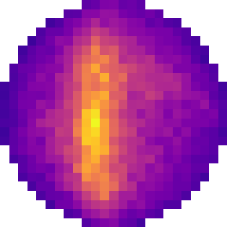

# fringe  

> Radio interferometer simulator producing **time-domain antenna signals** for FFTT and interferometric signal-processing pipelines.

#
**fringe** is a radio interferometer simulator that generates **complex time-domain voltage samples per antenna**, rather than visibilities.

Unlike most existing simulators, fringe is designed specifically for **FFTT imaging and calibration pipelines**, where the time domain signals are required. Instead of correlating signals internally, the simulator produces synchronized complex sample windows for every antenna, allowing downstream software to perform correlation, beamforming, calibration, or FFTT imaging as required.

The project is implemented in Rust and can be used as:

- a standalone command-line application
- a Rust library
- a native Python module

Both CPU and GPU execution are supported, with the runtime selected dynamically.

---

## Scientific Background

fringe was developed as part of a Master's thesis.

The accompanying thesis (`thesis.pdf`) describes

- the context this project was developed for
- the signal generation approach
- implementation details
- validation methodology
- performance considerations

The appendix includes verification results in which simulated antenna signals
generated by fringe were converted into visibilities and imaged using WSClean.
The resulting images were compared against an equivalent Sagecal/WSClean
simulation pipeline, demonstrating agreement between the two approaches.

## Features

- Generate complex time-domain samples for every antenna
- Designed specifically for FFTT imaging pipelines
- Large-N array support
- Large point-source sky models with power-law spectra, optionally curved by 2nd and 3rd order spectral indices, and optionally polarized (linear, circular, rotation measure)
- Antenna beams: analytic, or far fields imported from openEMS or given as arrays, with per-antenna orientation and dual-polarized antennas
- Calibrators: SDR-style transmitters playing cyclic IQ buffers from moving positions, including Doppler, with optional directive beams and attitude
- CPU runtime (multi-threaded)
- Cross-platform GPU runtime (using `wgpu`)
- Executable with command-line interface 
- Native Python module (using `PyO3`)

## Architecture

The project consists of three interfaces built from the same Rust codebase.

| Target | Description |
|---------|-------------|
| CLI | Standalone executable |
| Python module | Native extension built with PyO3 |
| Rust library | For integration into Rust projects |

The simulation backend is shared between all three.

## Web frontend

[fringe-frontend](https://github.com/samvandenende/fringe-frontend) is a separate (experimental) browser-based
environment built on the Rust library. It can be used to

- configure the array, sky model and calibrator, and load or export them in fringe's file formats
- run simulations on the CPU or GPU runtime
- inspect the time-domain antenna samples, spectra and waterfalls
- form beamformed sky images and compare them against the analytic expectation

---

## Units

All signals share one unit, so sky sources, receiver noise and calibrators can be combined consistently.

| Parameter | Unit |
|---|---|
| `Source` `reference_intensity` | Flux density in Jy (1 Jy = 10⁻²⁶ W m⁻² Hz⁻¹) at `reference_frequency` |
| `Source` `spectral_index`, `spectral_index_2`, `spectral_index_3` | Dimensionless, see below |
| `Source` `polarization_angle` | Radians, from north through east |
| `Source` `rotation_measure` | rad/m² |
| `Array` `system_noise_temperature` | K, constant or as `(frequency (Hz), temperature (K))` pairs, see below |
| `Transmitter` `power` | W: the equivalent isotropically radiated power without a beam, the power fed to the beam with one |

The output samples are in √Jy, relative to the reference area A<sub>ref</sub>(f) of the array: the largest peak effective area of its beams (`Array.reference_area(f)`).

Their mean power is the flux density received by an antenna with effective area A<sub>ref</sub>, averaged over the sample frequency f<sub>s</sub>. With A<sub>e</sub> the effective area of an antenna in the direction of a signal:

- an unpolarized source with flux density S, flat over the bandpass of width B, gives a mean power of ½·(A<sub>e</sub>/A<sub>ref</sub>)·S·B/f<sub>s</sub>. Every receiver is a single polarization, which receives half the flux density of an unpolarized source
- receiver noise with temperature T is received as a flux density of k<sub>B</sub>T/A<sub>ref</sub>, a noise power spectral density of k<sub>B</sub>T. For a single polarization this is the noise of an unpolarized source with the system equivalent flux density 2k<sub>B</sub>T/A<sub>e</sub>
- a calibrator at distance d gives a power flux density of G<sub>tx</sub>·P/(4πd²) W/m², spread over f<sub>s</sub> and received with A<sub>e</sub>/A<sub>ref</sub> and the polarization mismatch of the two beams. A calibrator whose signal is white over f<sub>s</sub> is therefore received like a fully polarized source of G<sub>tx</sub>·P/(4πd²f<sub>s</sub>)·10²⁶ Jy

With the default beam (`Beam.cos_squared()`), A<sub>e</sub>/A<sub>ref</sub> = cos²θ and A<sub>ref</sub> = min(λ²/4, 4 m²), as in earlier versions of fringe, which however did not apply the factor ½ to unpolarized sources.

The system noise temperature is the same for every receiver. It is either a constant, or a table of `(frequency, temperature)` pairs with increasing frequencies that covers the bandpass, which is interpolated linearly in frequency.

The sky is simulated from the sources, so the temperature should be the receiver's own noise (plus any noise that is not simulated, such as ground pickup), not a T<sub>sys</sub> that includes the sky. It is referred to the same point as the beam:

- for a beam in realized gain, which includes the mismatch and losses of the antenna, it is the receiver's noise temperature at its input
- for a beam in directivity, it is referred to the lossless, matched antenna: T<sub>rec</sub>/(η(1 − |Γ|²))

```python
array = fr.Array(positions, 250e6, 0.0, 50e6, 100e6, 4096, [(50e6, 3000.0), (75e6, 1500.0), (100e6, 1000.0)])
```

A source's flux density at frequency f follows a log-polynomial spectrum (natural log), with S₀ = `reference_intensity`, f₀ = `reference_frequency` and α₁, α₂, α₃ = `spectral_index`, `spectral_index_2`, `spectral_index_3`:

S(f) = S₀ · exp(α₁x + α₂x² + α₃x³), with x = ln(f/f₀)

With α₂ = α₃ = 0 this is the power law S₀ (f/f₀)^α₁.

A source may be polarized, with linear polarization fraction p = `polarization_fraction`, angle χ₀ = `polarization_angle`, rotation measure RM = `rotation_measure` and circular polarization fraction v = `circular_fraction`:

Q = p·S·cos 2χ, U = p·S·sin 2χ, V = v·S, with χ = χ₀ + RM·λ²

Polarization is given in the basis of north (towards +z, increasing declination) and east (increasing right ascension) on the sky, with χ measured from north through east. The field (E<sub>north</sub>, E<sub>east</sub>) has coherency ½·[[I + Q, U + iV], [U − iV, I − Q]].

In the sky model CSV, the `spectral_index_2`, `spectral_index_3`, `polarization_fraction`, `polarization_angle`, `circular_fraction` and `rotation_measure` columns are optional and default to 0.

---

## Beams

Every antenna has a `Beam`, and an `Orientation` that places it in the world frame. A beam is defined in its own frame, the frame of the antenna model it was simulated in: θ is measured from its +z axis and φ from its +x axis.

`Orientation(boresight, reference)` points the model's +z axis along `boresight` and its +x axis as close to `reference` as possible. The default is the identity, with the boresight at the zenith (+z).

| Beam | Description |
|---|---|
| `Beam.cos_squared()` | The default: relative gain cos²θ, effective area min(λ²/4, 4 m²), no polarization |
| `Beam.short_dipole()` | Short dipole along the beam's +x axis, directivity 1.5 |
| `Beam.isotropic(e_theta, e_phi)` | Unit gain with a fixed polarization |
| `Beam.load_openems(file, incident_power=None, excitation=None)` | Far field computed by openEMS (`CalcNF2FF` HDF5 output), normalized to directivity using its `Dmax`, or to realized gain with the port's incident power. Give the port's incident voltage `port.uf_inc` as `excitation` to keep the antenna's phase response, see below |
| `Beam(frequencies, theta, phi, e_theta, e_phi, normalization)` | Far field from arrays, e.g. from any other simulation software |

Tabulated beams hold the complex far field (E<sub>θ</sub>, E<sub>φ</sub>), so they include the polarization and phase of the antenna. A beam is zero outside the θ range of its grid, so a hemisphere is enough for an antenna over a ground plane.

The grid may use any θ/φ convention, such as θ ∈ [−180°, 180°) with φ ∈ [0°, 180°) as in the openEMS examples, as long as the directions form a regular grid with φ around the full circle.

The far-field phase should be referenced to the antenna's feed or phase center (the nf2ff `center` in openEMS). The phase across frequencies is the antenna's phase response, which delays the received signal by its group delay.

openEMS computes the far field of its excitation pulse, so its phase includes the delay of the pulse. `Beam.load_openems` removes it with the `excitation` (`port.uf_inc` after `port.CalcPort`). Without it, the phase at every frequency is referenced to the direction of the peak gain, which drops the antenna's group delay.

Use `beam.diagnostics()` to check an imported beam: it lists its grid, frequencies, peak gain and gain integrated over the sphere, which is about 1 for directivity and the radiation efficiency for gain.

```python
beam = fr.Beam.load_openems("nf2ff.h5")
print(beam.diagnostics())
array = fr.Array.dual_polarized(positions, 120e6, 0.0, 15e6, 45e6, 4096, 1.8e6, beam=beam, horizon=fr.Vec3(0, 0, 1))
```

`Array(..., beams, antenna_beams, antenna_orientations, horizon)` gives every antenna a beam and orientation. If `horizon` is given, nothing is received from below the horizon.

A receiver is one polarization channel: `Array.dual_polarized` makes two receivers per antenna, receiver 2i the X polarization of antenna i and 2i + 1 the Y polarization, rotated by 90° about the boresight.

For realistic beams, simulate the complete antenna including its ground plane or regolith, with both feeds of a dual-polarized antenna as lumped ports: excite one port and terminate the other in its load impedance.

If the antenna has 90° rotational symmetry, the second polarization is the same beam rotated by 90°, otherwise simulate each port. Receiver noise is independent per receiver, so noise correlated by mutual coupling is not modeled.

Arrays are saved with `save_array`, with tabulated beams next to the array file in fringe's beam format: a JSON header and a raw interleaved little-endian 32-bit float IQ file (`cf32_le`) holding E<sub>θ</sub> and E<sub>φ</sub>. Beams are saved on their own with `save_beam` and loaded with `load_beam`.

Array files can also refer to openEMS far fields directly, e.g. `"beams": [{"kind": "openems", "file": "nf2ff.h5"}]`.

---

## Calibrators

A calibrator is a known emitter, such as a satellite, used to calibrate the array. Each calibrator has a `Transmitter`, configured like a software defined radio:

| Parameter | Meaning |
|---|---|
| `frequency` | Carrier frequency (Hz) |
| `sample_rate` | Rate at which the buffer is played out (Hz) |
| `power` | Power (W): the equivalent isotropically radiated power without a beam, the power fed to the beam with one; buffer samples are relative levels, scaled such that playing the buffer cyclically radiates `power` |
| `buffer` | Complex baseband samples, transmitted cyclically |
| `bandwidth` | Optional reconstruction filter bandwidth (Hz) |
| `start_time` | Time (s) at which the first buffer sample is transmitted |
| `beam` | Optional `Beam` of the transmitter (directivity, gain or realized gain); without one the transmitter is isotropic and polarization matched to every receiver |

The calibrator moves with constant acceleration from its `position` and `velocity` at `epoch`. The received signal is computed from the exact light-time delay to every antenna, so it includes carrier and code Doppler. Signals of consecutive sample windows are continuous in time.

The calibrator's `attitude` orients its transmitter's beam: `Attitude.fixed(orientation)`, or `Attitude.point_at(target, reference)` to track a point such as the array center.

The link between the transmitter's and every receiver's beam includes both gains, their polarization mismatch and their phase, which is a delay that varies with frequency.

The link is evaluated for the geometry at the middle of every sample window. If any of the beams is tabulated, the link response varies with frequency and every calibrator is filtered by its own link response across the band.

```python
transmitter = fr.Transmitter(frequency=75e6, sample_rate=50e6, power=10.0, buffer=iq, beam=fr.Beam.short_dipole())
calibrator = fr.Calibrator(position, transmitter, velocity=velocity, acceleration=acceleration,
                           attitude=fr.Attitude.point_at(fr.Vec3(0, 0, 0), fr.Vec3(1, 0, 0)))
sim.set_calibrators([calibrator])
sim.start(time=0.0)  # later calls to sim.start() continue where the previous window ended
```

Calibrators are saved with `save_calibrators` as a JSON list, with each transmit buffer in a raw interleaved little-endian 32-bit float IQ file (`cf32_le`) next to it, and tabulated transmitter beams in fringe's beam format.

Calibrator signals are filtered by the array's bandpass like the sky. Near the band edges this filter is softened over about `sample_frequency / ((frequency_resolution - 1) * sample_window_size / 2)` Hz.

---

## Execution backends

Fringe supports two execution backends:

- CPU
- GPU

The CPU backend distributes work over all available cores. The field of every source is computed once per sample window and received through the beam of every group of receivers with the same beam and orientation; the receivers add it, delayed geometrically, in parallel.

The GPU backend uses

- `wgpu`
- WGSL compute shaders

The execution backend is selected at runtime, allowing the same application to execute on systems with varying operating systems with or without GPU acceleration.

---

## Repository Layout

```
fringe/
├── src/
├── examples/
├── tests/
├── thesis.pdf
├── Cargo.toml
├── fringe.pyi
├── install_python_lib.sh
└── ...
```

## Examples

The `examples/` directory contains examples of how to use fringe.

Current examples include:

- A python script which loads an example array and sky model, simulates antenna data, and creates a sky image.
- A python script which simulates a calibrator satellite in orbit, estimates its time of arrival at every antenna, and compares the accuracy to the Cramér-Rao bound.
- A python script which simulates a dual-polarized array with a tabulated beam (or an openEMS far field) observing a polarized source, recovers its Stokes parameters, and receives a calibrator with a directive transmitter.

## Tests

The `tests/` directory contains verification tests for the simulator.

Current tests include:

- Verification of CPU and GPU outputs being qualitatively identical. The outputs of both backends are compared sample-by-sample and are expected to agree upto floating-point rounding errors.

Unit tests of the library, including verification of the calibrator signal model, run with `cargo test`.

---

## Requirements

## Rust

Install Rust/Cargo using:

https://rustup.rs/

A recent stable Rust compiler is recommended. It is recommended to do the standard installation.


## Python 

Python bindings require Python 3.

The bindings are implemented using PyO3 and are built automatically through Cargo.


## GPU

GPU execution requires a graphics API supported by `wgpu`, such as:

- Vulkan
- Metal
- DirectX 12
- OpenGL (where supported)

If no compatible GPU is available, the CPU backend can always be used.

---

## Cloning

Clone the repository:

```bash
git clone https://github.com/samvandenende/fringe.git
cd fringe
```

## Installing the CLI

Build and install the executable:

```bash
cargo install --path .
```

## Installing the Python Module

The repository includes a helper script:

```bash
./install_python_lib.sh
```

The script will:

1. build the Python module in release mode
2. locate your local Python site-packages directory
3. install the compiled library and `fringe.pyi` stubs

After installation:

```python
import fringe
```

works like any other Python package.

---

## Platform Support

| Platform | Status |
|----------|--------|
| Linux | Tested |
| Windows | Expected to work (untested) |
| macOS | Expected to work (untested) |

---

## Intended Applications

Fringe is intended for:

- FFT Telescope calibration research
- Radio interferometer algorithm development

## Citation

If you use `fringe` in research work, consider citing the thesis or project repository.
